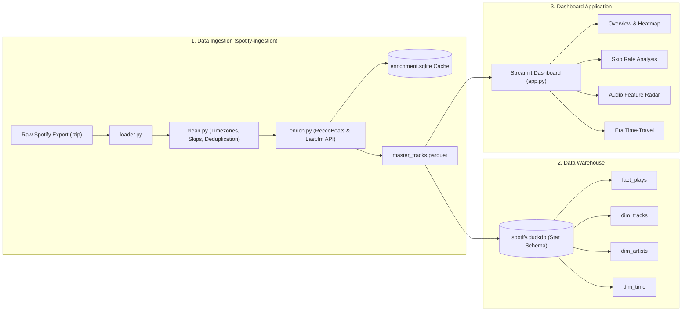

# 🎵 Spotify Listening History Dashboard

[](https://www.python.org/)
[](https://streamlit.io/)
[](https://duckdb.org/)
[](https://plotly.com/)
[](LICENSE)

An end-to-end data analytics dashboard and warehouse for your Spotify streaming history. Transform raw Spotify account export files into an enriched dimensional warehouse and explore your listening habits with an interactive Streamlit dashboard.

---

## 🌟 Highlights

- **Interactive Visualizations**: Top artists & tracks, listening activity heatmaps, monthly listening trends, and skip behavior.
- **Vibe & Audio Feature Radar**: Track danceability, energy, valence, acousticness, speechiness, and more throughout different hours of the day.
- **Era Time-Travel**: Analyze your musical journey across release years and decades.
- **Embedded OLAP Warehouse**: Powered by DuckDB with a clean dimensional star schema (`fact_plays`, `dim_tracks`, `dim_artists`, `dim_time`).
- **Resilient Ingestion Pipeline**: Ingests Spotify streaming history zips, hashes surrogate keys, and caches API enrichments (ReccoBeats & Last.fm).

---

## 🏗️ Architecture



---

## 📁 Repository Structure

```
Spotify-Listening-History-Dashboard/
│
├── .streamlit/
│   └── config.toml               # Streamlit theme & UI configurations
├── app.py                        # Streamlit web dashboard entrypoint
├── master_tracks.parquet         # Processed master listening dataset
├── spotify.duckdb                # DuckDB dimensional warehouse database
├── .gitignore                    # Root gitignore rules
├── README.md                     # Project documentation
│
└── spotify-ingestion/            # Ingestion & enrichment pipeline
    ├── ingest.py                 # CLI entry point for ingestion
    ├── requirements.txt          # Python dependencies for ingestion
    ├── README.md                 # Ingestion-specific documentation
    ├── .env.example              # Example environment credentials
    ├── data/
    │   ├── raw/                  # Place raw Spotify .zip exports here (git-ignored)
    │   ├── processed/            # Generated parquet, csv, and ingest reports
    │   └── cache/                # SQLite cache for API enrichment results
    ├── ingestion/
    │   ├── loader.py             # JSON zip extraction and loading
    │   ├── clean.py              # Timezone parsing, skip tagging, surrogate keys
    │   ├── enrich.py             # Audio features & tag lookups
    │   └── pipeline.py           # Orchestration pipeline
    └── tests/
        └── test_ingest.py        # Pytest test suite for pipeline
```

---

## 🚀 Getting Started

### 1. Prerequisites

- Python 3.9+ (Python 3.10 or 3.11 recommended)
- Git

### 2. Clone the Repository

```bash
git clone https://github.com/Alred-Rozario/Spotify-Listening-History-Dashboard.git
cd Spotify-Listening-History-Dashboard
```

### 3. Running the Dashboard

Install dashboard dependencies:

```bash
pip install streamlit duckdb pandas plotly
```

Launch the Streamlit app:

```bash
streamlit run app.py
```

The app will open automatically in your browser at `http://localhost:8501`.

---

## 📊 Dashboard Modules

### 1. Overview
- **Top 10 Artists & Tracks**: Ranked by total minutes played.
- **Listening Heatmap**: Play distribution by hour of day and day of week.
- **Monthly Trend**: Hours listened across months.

### 2. Skip Rate Analysis
- **Hall of Shame / Fame**: Identify artists with the highest and lowest skip rates (plays under 30 seconds).

### 3. Mood & Vibe
- **Audio Features Radar**: Polygon chart representing average danceability, energy, valence, acousticness, instrumentalness, and speechiness.
- **Hourly Mood Curves**: Track how your music's energy and happiness fluctuate throughout the day.

### 4. Era Time-Travel
- **Release Year Histogram**: Inspect how much of your listening is recent hits versus vintage classics.

---

## ⚙️ Data Ingestion Pipeline (`spotify-ingestion/`)

If you want to ingest your own Spotify export:

1. **Request your data from Spotify**: Go to Spotify Privacy Settings -> *Download your data* (Extended streaming history or account data).
2. **Setup virtual environment**:
   ```bash
   cd spotify-ingestion
   python -m venv .venv
   source .venv/bin/activate       # On Windows: .venv\Scripts\Activate.ps1
   pip install -r requirements.txt
   ```
3. **Run the ingestion CLI**:
   ```bash
   # Offline mode (reads data/raw/*.zip and produces processed datasets)
   python ingest.py

   # Specify export path & custom timezone
   python ingest.py --export "path/to/my_spotify_data.zip" --tz Asia/Kolkata

   # Online enrichment (Spotify API + ReccoBeats + Last.fm)
   python ingest.py --enrich
   ```
4. **Run tests**:
   ```bash
   python -m pytest tests/
   ```

---

## 🗄️ Dimensional Data Warehouse (DuckDB)

The project includes an embedded **DuckDB** warehouse (`spotify.duckdb`) modeled with a Star Schema:

- **`fact_plays`**: Granular play occurrences (`play_id`, `track_id`, `artist_id`, `played_at_utc`, `ms_played`, `is_skip`, `is_zero_play`).
- **`dim_tracks`**: Track metadata (`track_id`, `track_name`, `album_name`, `duration_ms`, audio features).
- **`dim_artists`**: Artist names and genre tags (`artist_id`, `artist_name`, `genres`).
- **`dim_time`**: Local timestamps, dates, hours, day of week, and weekend flags.

Query tables directly via DuckDB:

```python
import duckdb

con = duckdb.connect("spotify.duckdb")
print(con.execute("SELECT * FROM dim_artists LIMIT 5").fetchdf())
```

---

## 🛡️ Privacy & Security

- **Raw Data Isolation**: Raw Spotify export files contain sensitive user identifiers (payment, billing, IP, address) and are strictly excluded via `.gitignore`.
- **Anonymized Output**: Only cleaned, hashed listening metrics and public track audio metadata are stored in processed datasets.

---

## 🤝 Contributing

Contributions, issues, and feature requests are welcome!
Feel free to open an issue or submit a pull request.
